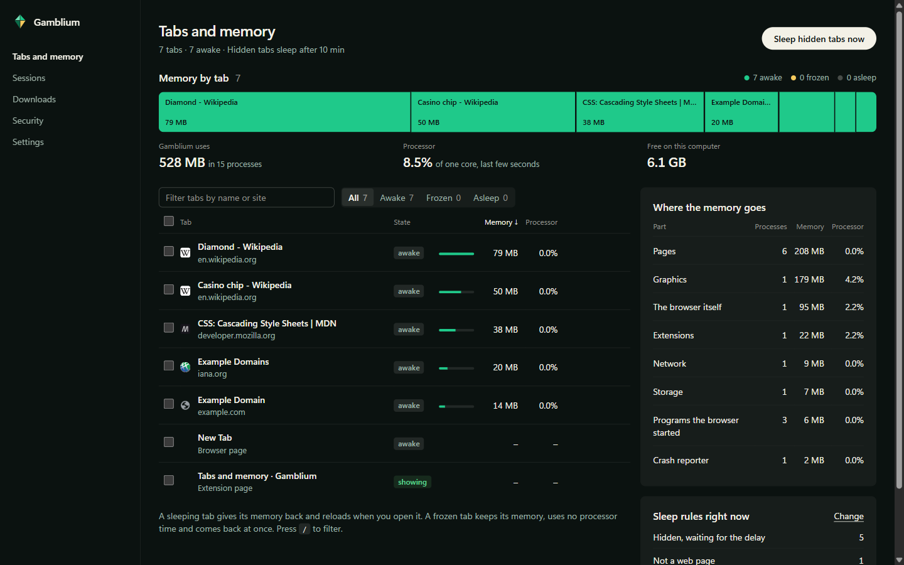
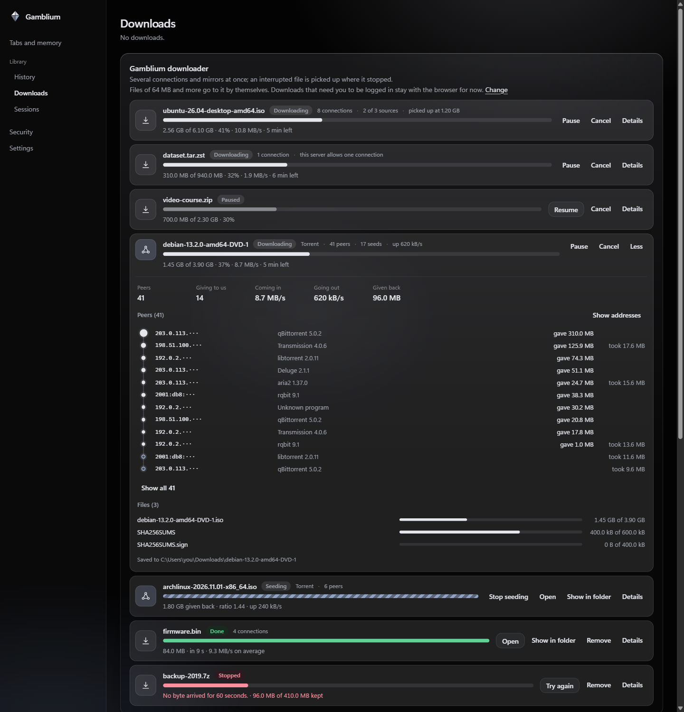
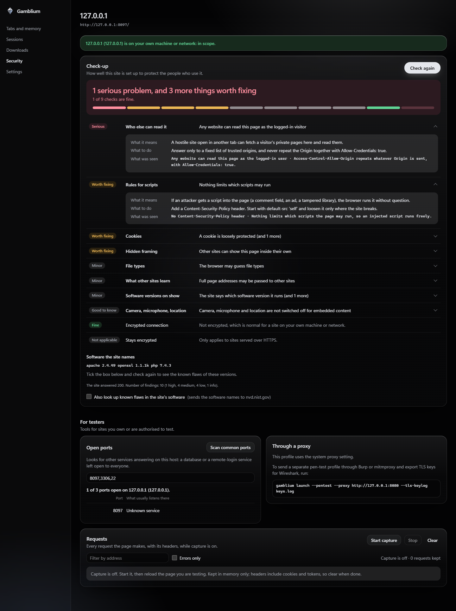
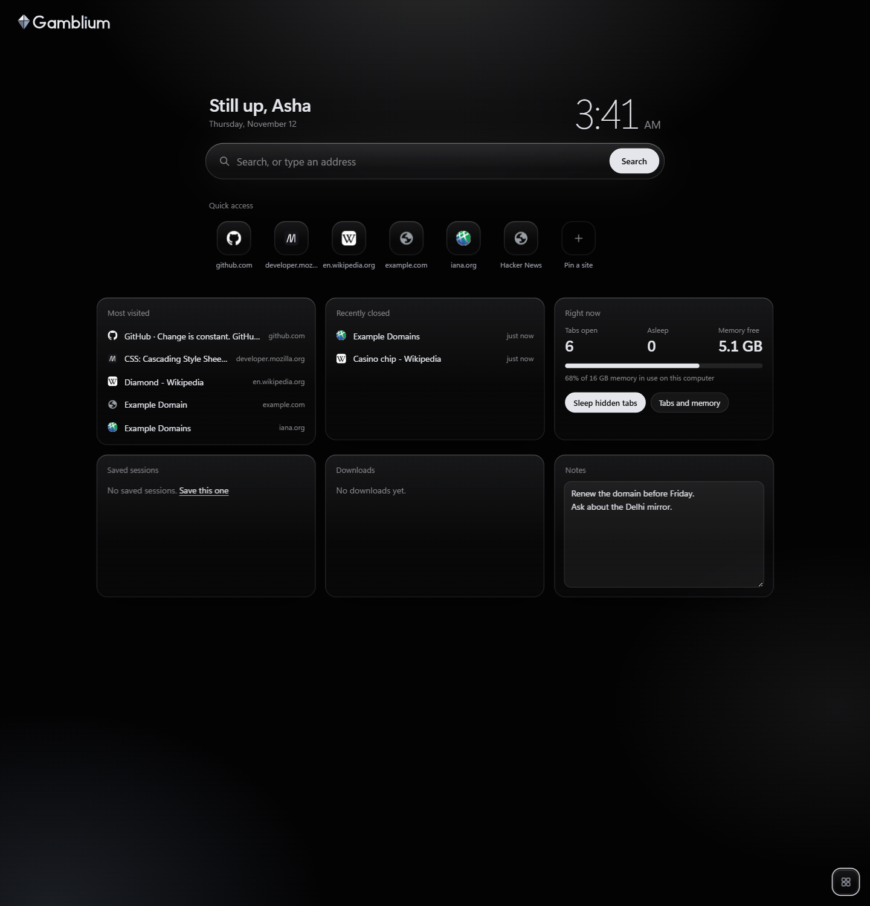
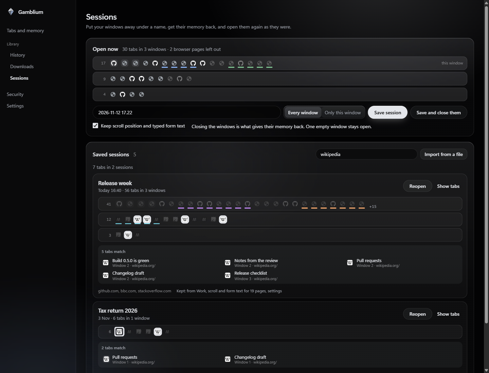

<p align="center">
  <picture>
    <source media="(prefers-color-scheme: dark)" srcset="branding/png/lockup-dark.png">
    
  </picture>
</p>

<p align="center">
  <b>A browser that stops working when you stop looking.</b><br>
  Hidden tabs freeze, idle memory goes back to Windows, and the whole thing stays quiet,
  private and scriptable. Built on Brave, for Windows.
</p>

<p align="center">
  <a href="https://github.com/JuteBags/Gamblium-open-source/releases/latest"><b>Download for Windows</b></a>
  ·
  <a href="#what-makes-it-different">What's different</a>
  ·
  <a href="#measured">Numbers</a>
  ·
  <a href="docs/agent-cli.md">For AI agents</a>
</p>

---

Most browsers keep every tab you opened this morning running: scripts, timers, animations,
hundreds of megabytes each, whether you look at them or not. On a 16 GB laptop with three windows
of fifteen tabs, a few dev servers and an AI agent driving its own browser, that is the whole
machine.

Gamblium is Brave (its ad blocking, fingerprint protection, Shields, Chrome Web Store) with an
engine on top that decides, tab by tab, what deserves to keep running:

- **30 seconds hidden:** the tab is **frozen**. No CPU at all, and it comes back in about a tenth
  of a second, exactly as you left it: scroll position, half-typed text, video paused where it was.
- **5 minutes hidden:** its memory is **trimmed**, pushed out of RAM. Still instant when you
  return.
- **30 minutes hidden:** it is put to **sleep** and its memory is freed. It reloads when you open it.
- **Short on memory?** Tabs that cost the most and were used the longest ago go to sleep within a
  minute, only as many as needed.

Never touched: the tab you are looking at, anything playing sound, uploads in progress, the
other half of a split view, and any tab or site you mark **Keep awake** (right-click). Mail and
chat sites can be woken on a schedule instead, with a per-site slider from 0 K (frozen solid) to
273 K (never frozen).



## Install

1. Download **`Gamblium-Setup-1.0.0.exe`** from the
   [latest release](https://github.com/JuteBags/Gamblium-open-source/releases/latest).
2. Run it. It installs for your Windows user only (no admin rights) and the browser is inside;
   there is nothing else to install.
3. The welcome page asks your name and your look, and you are done.

The installer is not code-signed yet, so Windows SmartScreen may say "unknown publisher":
**More info → Run anyway**. Each release lists the installer's SHA-256 in `SHA256SUMS.txt`.
Gamblium **updates itself**: it checks once per start, downloads in the background, verifies the
checksum, and shows **Restart to update** in its menu; your windows and tabs come back after.

## What makes it different

### Your tabs, under control
- **Freeze → trim → sleep**, per tab, on timers you can change, with the exceptions above.
  Brave's own freezer cannot make per-tab exceptions; ours is in the extension, so it can.
- **Tabs and memory**: real memory and CPU **per tab**, per tab group and per browser part,
  read from Windows by Gamblium's helper (extensions in Brave cannot see processes). Point at a
  row and that tab lights up in the tab strip.
- **Tab groups that do more**: sleep or keep a whole group awake in one click, give a group a
  **memory or CPU limit** it is held to, fold the other groups away, and reopen a **closed group**
  from New Tab, with its name, colour and tabs.

### A download manager built in (in Rust)
- **Adaptive connections**: starts with one, doubles while it pays, backs off when a server
  objects. Several mirrors of one file at once, each piece from whichever is fastest.
- **Resume anything**, including **downloads behind a login**: the cookie is kept sealed
  (XChaCha20-Poly1305, key wrapped by Windows for your account), tied to that download and site,
  never longer than a day, and deleted the moment the file is whole.
- **Torrents and magnet links** in the same downloader (librqbit), with web seeds. Magnet links
  anywhere in Windows open in Gamblium.
- Big files are handed over from the browser automatically; one Downloads page for all of it.



### Made to be driven by AI agents
- **`gamblium ctl`** and named sessions (**`gamblium-cli`**): about 90 commands for tabs, pages,
  forms, input, downloads, cookies, network capture and screenshots, from any terminal or script.
  Reference: [docs/agent-cli.md](docs/agent-cli.md).
- Sessions run **hidden** (no window) and **lean**: a page loads, the agent acts, the page freezes
  again. An 8-site agent job peaked at ~715 MB and idled at 0.2 % of one core.
- **Full-page screenshots of any length** (a 54,000 px article in ~4 s), stitched by the helper.
- **Sessions pack themselves** when closed: ~0.1 MB each instead of 20–100 MB, logins kept.
- **Honest about bot walls**: a Cloudflare or captcha check is recognised and reported, never
  evaded. A person opens the session in a window and passes it.
- **Agents ask before changing settings**, like Windows UAC: always, for 30 min, for a few hours,
  or never.

### For authorised security testing
- A separate **pen-test profile** with a proxy switch (Burp, mitmproxy), TLS key export and none
  of the browser's own background traffic going through your proxy.
- **Request capture** with one-click `curl` export, a **site security audit**, **known-CVE lookup**
  for a software version, and a **TCP port scan**, all limited to a scope you write. No "attack
  anything" defaults.



### Private and quiet
- Telemetry, P3A, usage stats and Web Discovery **off**, checked with a 10-minute network log.
- Brave Rewards, Wallet, VPN, News, AI chat and Playlist **off by policy**; Tor windows kept.
- The Gamblium extension works in **private and Tor windows** too; right-click any link →
  *Open in a Tor window*.
- **Gamblide**, our own panel for the site you are on, in place of Brave's Shields panel.

### Looks like one thing
- One colour seed themes the whole browser (frame, tabs, menus, settings). **Forced dark** for
  light-only sites, with a keep-light list for the ones that should stay as they are.
- Our own **New Tab** with widgets you can move and resize, **Sessions**, **History** and
  **Downloads** pages, an editable **shortcuts** list, and a **welcome** page.
- Gamblium's name and mark everywhere, the lion included, in a private copy of Brave; Brave
  itself is never changed.

<p>
  
  
</p>

## Measured

On the author's laptop (Windows 11, i5-12450H, 16 GB), Gamblium 1.0.0 betas against Brave
1.99.57 with the same 45 real sites in 3 windows. Ranges span the tester's runs: medians of 3 alternating
runs on two days and a later clean pair, on mains power. Single runs say so.

| | Gamblium | Brave | |
|---|---|---|---|
| CPU spent loading 45 tabs (first 120 s) | 258–263 core-s | 305–315 core-s | **−15 to −17 %** |
| Peak CPU while loading | 790–922 % | 1054–1144 % | **−19 to −25 %** |
| Memory, idle at 5 min | 3.4–5.1 GB | 5.5–5.7 GB | **−10 to −39 %** |
| A frozen tab coming back | 77–264 ms | – | |
| New-profile start / warm start | ~1.9 s / ~0.7 s | ~0.55 s | slower: we set the profile up first |

The memory saving depends on how full the machine is: the −39 % runs had less than 2 GB free,
which sends hidden tabs to sleep early. 1.0.0 adds the always-on 5-minute trim, which is not in
these numbers yet. Idle CPU after 5 minutes was about even with Brave (4.3–4.8 % against
5.2–6.1 % of one core).

Downloads: as fast as aria2 with 16 connections on the same line (8.6 against 8.8 MiB/s from
kernel.org, one run), and faster than Brave's own downloader on servers that are slow per
connection (96 MB in 10 s against 24 s).

## Built from the source

```
cargo build --release
target\release\gamblium.exe install
```

Needs Rust (stable, MSVC), Python 3.10+ with Pillow and numpy (for the rebranding), and Brave
installed. `gamblium install` puts the programs in your user folder and makes the rebranded copy
of Brave by itself.

| Part | What it is |
|---|---|
| `crates/gamblium` | Launcher, native helper, installer, rebrander, updater, agent bridge, session packer, pen-test tools |
| `crates/gamblium-dl` | The downloader: HTTP(S) with adaptive connections and mirrors, torrents and magnets |
| `extension/` | The companion extension: freezing, sleeping, Tabs and memory, New Tab, Sessions, Downloads, Settings, the agent commands |
| `tools/rebrand/` | Puts Gamblium's mark and name into the private copy of Brave |
| `presets/` | Debloat, new-profile and theme presets |
| `tools/` | Benchmarks and end-to-end checks against a real browser |

## Credits

Gamblium exists because of other people's work:

- **[Brave](https://brave.com)** by Brave Software, Inc. Gamblium uses the official Brave browser
  as its engine, including Brave Shields and its Rust ad-block engine. Brave's source is at
  [brave/brave-core](https://github.com/brave/brave-core) and
  [brave/brave-browser](https://github.com/brave/brave-browser), licensed MPL-2.0.
- **[Chromium](https://www.chromium.org)**, the engine underneath Brave, by The Chromium Authors
  (BSD-3-Clause and others).
- **[Helium](https://github.com/imputnet/helium)** and
  **[ungoogled-chromium](https://github.com/ungoogled-software/ungoogled-chromium)**, which shaped
  the idea of a lean, quiet browser and were measured as alternative bases.
- **[librqbit](https://github.com/ikatson/rqbit)** (Apache-2.0), the torrent engine.
- **[aria2](https://aria2.github.io)** (GPL-2.0), used as a yardstick in download benchmarks.
- **[Simple Icons](https://simpleicons.org)** (CC0 1.0): the outlines of the site marks on the new
  tab page and the welcome page (`extension/site-icons.js`). The marks themselves are trademarks of
  their owners and only point at their own sites.

Gamblium is an independent project. It is not affiliated with, endorsed by or sponsored by Brave
Software. "Brave" is a trademark of Brave Software, Inc. See `NOTICE.md`.

## Licence

Gamblium's own code (the launcher and helper, the downloader, the extension, the presets and the
tools in this repository) is free software under the
[GNU General Public License, version 3](LICENSE). You may use, study, change and share it; if you
pass on a changed version, it must stay under the same licence with its source.

This repository holds none of Brave's or Chromium's source. Their licences (MPL-2.0, BSD-3-Clause
and others) apply to their programs. Libraries we build on keep their own licences, among them
librqbit (Apache-2.0).
