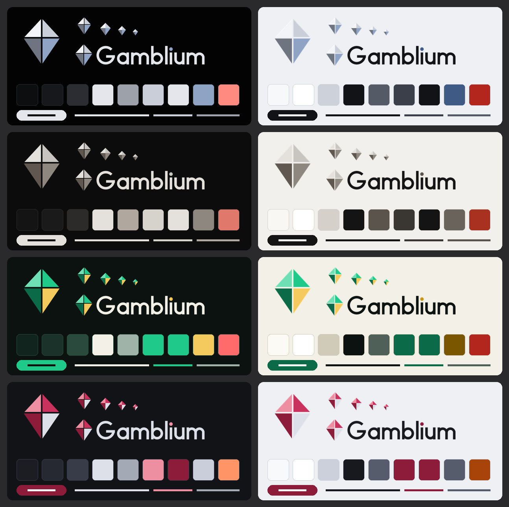

# Brand

Everything here is built by one script from one colour file:

```
python branding/make_icons.py
```

It reads `palette.json` and writes the mark, the wordmark, every icon size, the
`.ico`, the CSS tokens for our pages and the whole-browser theme presets. Change
a number or a colour, run it again, and every asset follows. Do not edit the
outputs by hand.

## Schemes

`palette.json` holds colour schemes. Each has a dark and a light side. The owner
picks; `"default"` names the one the app icon and the extension use.

| Scheme | Idea |
|---|---|
| `felt` | Casino table: ink, green felt, emerald, gold. |
| `burgundy` | Burgundy and moonlight grey: cool grey surfaces, a wine accent, silver highlights. |



The default scheme's files sit in `branding/`. Every other scheme has the same
set in `branding/schemes/<name>/`.

## The mark

A casino chip whose rim is the letter G: a ring, open at the upper right, with a
crossbar, on a disc. The disc keeps it readable on any background.

- `gamblium-mark.svg`: 48 px and larger, with four rim stripes.
- `gamblium-mark-small.svg`: 16 to 32 px. No stripes, thicker ring. At 16 px the
  ring is 3 px wide and the bar 3 px high.
- `gamblium.ico`: 16 to 256 px in one file, for the exe and shortcuts.
- `png/contact-sheet.png`: every size on dark and light, small sizes again at 6x.

## The wordmark

"Gamblium" drawn from stems, bowls and arches on a grid, so it needs no font
file. The dot of the i is a coin. `gamblium-wordmark-*.svg` is the text alone,
`gamblium-lockup-*.svg` is mark plus text. `dark` and `light` name the
background they sit on.

## Tokens for pages

Pages use semantic names, never raw colours: `bg`, `surface`, `surface-raised`,
`border`, `text`, `text-muted`, `accent` (safe as text), `accent-strong` (a
fill), `on-accent` (text on that fill), `highlight`, `danger`.

`extension/ui/tokens.css` carries them as CSS variables: the default scheme on
`:root`, others under `:root[data-scheme="<name>"]`, light values inside
`prefers-color-scheme: light`. The script checks 40 text pairs; all are above
4.5 to 1.

## Theming the whole browser

`presets/theme-<scheme>-<dark|light>.json`, laid over by the launcher. Prefs
only, no theme extension:

| Pref | What it does |
|---|---|
| `browser.theme.user_color2` | The seed colour. Brave derives the frame, tab strip, toolbar, address-bar dropdown, menus and its internal pages (settings and the rest) from it. |
| `browser.theme.color_variant2` | How strongly the seed tints surfaces: 1 tonal, 2 neutral, 3 vibrant. |
| `browser.theme.color_scheme2` | 2 dark, 1 light. Web pages see the same choice through `prefers-color-scheme`. |
| `extensions.theme.id`, `.pack` = "" | Removes an installed theme extension. One would keep the frame and toolbar for itself and leave the rest to the seed, which looks half themed. |
| `brave.new_tab_page.background` | The stock new tab page in the scheme's background colour. |

Seen on Brave 1.99.56, throwaway profiles, in dark and light, for an emerald and
a burgundy seed: window, tab strip, toolbar, address-bar dropdown, settings page
with its toggles and checkboxes, app menu, context menu.

What a preset cannot do:

- **Exact colours.** Brave picks the tones. In dark mode controls get a light
  tone of the seed: mint for emerald, rose for burgundy. Our exact colours appear
  only in our own pages.
- **Brave's orange lion** in the settings header, the address-bar chip and the
  Shields button.
- **Web pages.** See forced dark below.

## Forced dark for websites

`--enable-features=WebContentsForceDark` (the launcher's `--force-dark`) darkens
sites that only have a light design. Sites with their own dark design keep it.
Checked on five sites with page screenshots: a light-only site and a news site
turned dark with readable text, photos were left alone, a canvas web app turned
dark, a site with its own dark design did not change.

A page whose root has `color-scheme: only light` is left light. That is the
per-site off switch: the extension keeps a list of sites and gives exactly those
one static CSS file (`extension/ui/keep-light.css`).
