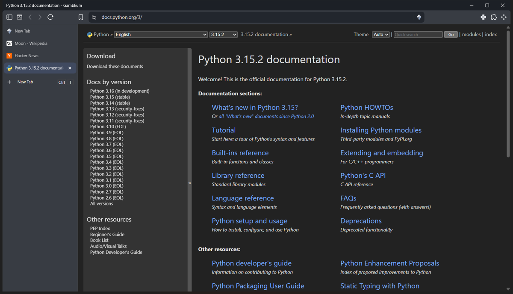

# Brave's own features on Gamblium (Brave 1.99.57 / Chromium 157)

What the browser underneath already does, whether it works on our build, what it costs, and
what Gamblium adds on top. Checked Nov 14 2026 on the installed, rebranded build: test windows
(window captures only), the browser's own strings and preference names.

| Feature | In this Brave? | Works on our build | Cost (one idle run, 4 tabs) | Our default | What Gamblium adds / plans |
|---|---|---|---|---|---|
| **Vertical tabs** | Yes: `brave.tabs.vertical_tabs_*` (on, right side, collapsed, floating, hide when collapsed, scrollbar, title) | Yes, with our theme (picture below) | 0.42 % of a core, 442 MB commit, against 0.26 %, 469 MB with tabs on top: the same within noise | Off (Brave's default); one switch in our Settings is planned | Nothing breaks: our freezer and sleeper work per tab, not per strip |
| **Tree tabs** | Yes: `brave.tabs.tree_tabs_enabled` (needs vertical tabs) | Yes, with vertical tabs | Same run as above | Off | - |
| **Split view** (two pages side by side) | Yes: Chromium's side-by-side, with "Open link in split view", stacked or side by side, pin, drag to the window edge | Yes | Not measured (a split can only be made by hand) | Brave's default (on) | **Fixed (#181):** the second page of a split counts as on screen, so it is never frozen or put to sleep, and it thaws with its partner |
| **Tab hover preview** ("link preview") | Yes: "Tab hover preview card", with page picture and memory use (`brave.tabs.hover_mode`) | Yes | Pictures of tabs are kept while the card is on | Brave's default | A preview of a **link** before opening it (Chromium's Link Preview) is not in this build: no switch, no strings. Possible ourselves later: hover a link + Alt, page shown in a small card |
| **Tab groups** | Yes: name, colour, collapse, move to new window, "Group tabs on current origin", "Add all tabs to new group", "Close tabs not in group", saved groups (reopen later) | Yes | - | On | See "Tab groups: ours on top" below |
| **Containers** | Yes: colour-coded tabs with separate cookies ("Open in container", temporary containers) | Not yet checked | - | Off (Brave's default) | Fits our separate profiles for work / personal / agents; worth a test |
| **Workspaces** | Only inside Brave AI (Leo): "Creating a workspace" for an AI chat. Brave AI is off by policy, so none | - | - | Off | **Our Spaces** are different: named sets of tabs in a window that you switch between; nothing clashes |
| **Isolated (private) window, Tor window** | Yes | Yes | - | - | Our menu opens both; right-click a link > Open in a Tor window (#166, #168) |
| **Sidebar** | Yes (Brave Talk hidden, #166) | Yes | - | Off | Our menu links to its setting |

## Tab groups: ours on top (owner picks before anything is built)

What Brave does not do, and our extension and helper can:

1. **Sleep or freeze a whole group** in one click, and wake it in one click.
2. **Memory and CPU per group** on the group's row in Tabs and memory.
3. **Keep a whole group awake** (the 273 K level for every tab in it).
4. **Group automatically by site or by session** as tabs are opened, by rules you set.
5. **Save a group and close it**, reopening later with each tab's place and scroll position
   (Brave's saved groups keep only the addresses).
6. **A group as a Space**: turn a group into a Space and back.
7. **Close a group and remember it** on New Tab's Recently closed, with Undo.
8. **Group-level proxy or profile**: open a group's tabs through a proxy, or in a session.

